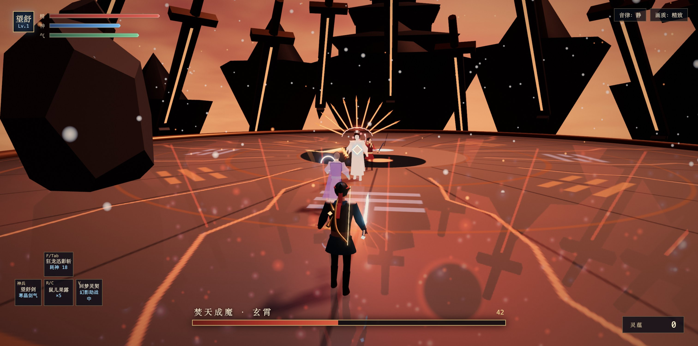

<div align="center">

# 回梦游仙 · 青春版 (Dream Wanderer)

**《仙剑奇侠传四》「冰火琼华·登顶卷云台」 × 《艾尔登法环》越肩 3D 魂系动作网页游戏**

[](https://finn-fengming.github.io/Dream-Wanderer/)
[](https://finn-fengming.github.io/Dream-Wanderer/?stage=boss)
[](https://finn-fengming.github.io/Dream-Wanderer/%E5%9B%9E%E6%A2%A6%E6%B8%B8%E4%BB%99%C2%B7%E9%9D%92%E6%98%A5%E7%89%88.html)

<br/>

<a href="https://finn-fengming.github.io/Dream-Wanderer/">
  
</a>

*点击上方徽章或封面图即可在浏览器直接开玩（支持键鼠与手机触屏双摇杆，无需安装任何插件）。*

</div>

---

## ✨ 项目简介

**《回梦游仙·青春版》** 是一款完全基于 **Three.js (WebGL2) + TypeScript** 从零构建的纯代码 3D 仙侠魂系动作网页游戏。

项目以《仙剑奇侠传四》最具宿命张力的高潮篇章 **「琼华飞升 · 卷云台决战」** 为舞台，完整复刻了 **《艾尔登法环》（Elden Ring）** 的越肩第三人称硬核动作博弈——从承天断桥的天地灵脉出发，突破寒晶长阶与守门机关巨傀，穿过金色剑幕雾门，迎战由 **「苍岚剑宗」** 入魔化为 **「焚天成魔」** 的双阶段 **玄霄**。

* **零外部重资产，696 KB 单文件装下整座琼华仙山**：无任何外部图片（`.png/.jpg`）、无外部 3D 模型（`.glb/.fbx`）、无外部录音（`.mp3`）。石砖法线、太极八卦阵纹、冰火苍穹着色器、连续 GPU 蒙皮角色、神兵流光与 32 小节《回梦游仙》国风配乐全部由数学与着色器实时生成。
* **电影级冰火渲染底座**：卷云台半透明寒玉地面挂载 **实时平面反射（Planar Reflection）** 倒映悬空九柄镇派巨剑；配备受控阈值 HDR Bloom、苍穹赤月蚀日天象渐变、相机跟随风雪与羲和流火粒子，以及 ACES Filmic 调色。
* **原谱级《回梦游仙》多阶段动态国风音律**：内嵌解析自《回梦游仙》完整 32 小节双声部乐谱（262 个主旋律音符 + 232 个古筝分解和弦音符），WebAudio 实时合成空灵竹笛、古筝泛音、战斗琵琶轮指与中国大鼓，随探索、Boss 一阶段、二阶段入魔无缝变奏。

---

## 🖼️ 实机画面一览

| 寒晶长阶 · 越肩剑战与高台奇珍 | 卷云台二阶段 · 主角团三人同框战入魔玄霄 |
| :---: | :---: |
|  |  |
| **越肩锁定执剑弟子、右侧断檐高台【琼浆玉露】光柱与远处镇岳剑傀** | **召唤韩菱纱 & 柳梦璃灵影，迎战展开九柄焚天幻剑翼的玄霄** |

<div align="center">
  
  <p><em>斩落二阶段玄霄结算演出：「宿 孽 获 诛」书法金字与百年青鸾峰回梦尾声</em></p>
</div>

---

## ⚔️ 《艾尔登法环》×《仙剑四》1:1 核心机制映射

| 《艾尔登法环》原版机制 | 《回梦游仙·青春版》仙剑映射 | 玩法细节说明 |
| :--- | :--- | :--- |
| **红 / 蓝 / 绿三色状态条** | **精（气血）/ 神（仙术）/ 气（精力）** | 绿条「气」严谨约束出剑、冲刺、翻滚与格挡；附带法环同款 **延迟扣血黄条**。 |
| **轻重连斩 & 腾空跳劈** | **望舒剑法（三连轻斩 / 蓄力重劈 / 坠星跳劈）** | 含攻击滑步吸附、按角色独立命中顿帧（Hit-stop）与噪声侵蚀弧形丝带刀光；**跳跃腾空可无伤躲过地面扩散震波**。 |
| **翻滚无敌帧（Dodge Roll）** | **踏步掠影（0.35s 核心无敌帧）** | 最高响应优先级，可随时打断出招后摇、蓄力与饮药动作。 |
| **防御反击 & 战技弹反** | **横剑格挡防反 & 剑气弹反（Parry）** | 挡住攻击瞬间按左键触发清脆金石防反音与高削韧重斩；`Q` 键精准弹反直接打崩敌方架势。 |
| **架势破韧与致命处决** | **护体剑罡崩解 &【御剑贯心】** | 蓄力劈、跳劈、防反打空敌方护体剑罡后，触发重低音钟鸣与单膝跪地，近身左键施展无敌处决！ |
| **双战灰切换（Ash of War）** | **【狂龙迅影斩】&【恸天贯日式·射日弓】** | 按 `Tab` 随时切换：居合寒芒突刺留延迟冰爆，或摘下背后【后羿射日弓】射出贯空赤金日轮箭。 |
| **赐福点 & 圣杯瓶 & 跑尸** | **【天地灵脉】、【鼠儿果露】、【残剑剑魄】** | 坐灵脉回满灵露、消耗「灵蕴」淬炼体魄/剑意、聆听菱纱与梦璃残影寄语；战败「梦碎」后可跑尸拾回遗落灵蕴。 |
| **骨灰召唤（Spirit Ashes）** | **【回梦灵契 · 故人幻影】** | 进入卷云台金色剑幕后左侧灵契亮起，按 `V` 吹笛召唤 **韩菱纱（双剑游走牵制）** 与 **柳梦璃（箜篌音律追击+回血阵）** 并肩作战！ |

---

## 🎮 操作指南

| 动作 | 键盘 + 鼠标 | 备选纯键盘 / 触屏 |
| :--- | :--- | :--- |
| **移动 / 冲刺** | `W A S D` / 按住 `Shift` | 移动端左下虚拟摇杆 |
| **踏步翻滚（无敌帧）** | 点按 `Shift` | `L` 键 / 触屏「翻滚」 |
| **轻斩三连 / 处决** | 点按 `鼠标左键` | `J` 键 / 触屏「出剑」 |
| **蓄力重劈 / 卸力防反** | 长按 `鼠标左键` | `H` 键 |
| **跳跃 / 腾空跳劈** | `Space` / 空中 `鼠标左键` | 触屏「跳跃」 |
| **横剑格挡 / 剑气弹反** | 按住 `鼠标右键` / `Q` | `K` 键 / `Q` 键 |
| **施展剑诀战技 / 切换战技** | `F` / `Tab`（或 `1` `2`） | 触屏「剑诀」 |
| **饮用灵药 / 切换红蓝瓶** | `R` / `C` | 触屏「饮药」 |
| **锁定目标 / 切换锁定** | `鼠标中键` 或 `Z` / `滚轮` | 触屏「锁定」 |
| **灵脉、拾取、穿雾门互动** | `E`（或直接点击提示条） | 点击屏幕互动提示 |
| **吹笛召唤菱纱 & 梦璃助战** | `V`（进入 Boss 金色雾门后可用） | — |
| **工程实时帧率与状态诊断** | `F3` | URL 加 `?debug=1` |

---

## 🔬 隐藏无尘研发检验展台（URL 参数直达）

借鉴《Saltline》与《雾锁山门》的模块化自检工程实践，项目内置了多套独立调试展台，点击即可在线查看：

* 🏔️ **场景光影与一/二阶段天象检验台**：[`?show=arena&q=ultra`](https://finn-fengming.github.io/Dream-Wanderer/?show=arena&q=ultra)
* 🗡️ **仙剑四全角色骨骼、神兵与招式拆解台**：[`?show=chars&q=ultra`](https://finn-fengming.github.io/Dream-Wanderer/?show=chars&q=ultra)
* 🔥 **跳过山道直达卷云台金色雾门前**：[`?stage=boss`](https://finn-fengming.github.io/Dream-Wanderer/?stage=boss)
* 🛡️ **无敌测招 + F3 实时碰撞/状态面板**：[`?stage=boss&god=1&debug=1`](https://finn-fengming.github.io/Dream-Wanderer/?stage=boss&god=1&debug=1)

---

## 🛠️ 本地运行与单文件 HTML 打包

环境要求：**Node.js 18+**。

```bash
# 1. 安装依赖
npm install

# 2. 启动本地开发热更新服务器
npm run dev

# 3. 生产构建（输出至 dist/，供 GitHub Pages 部署）
npm run build

# 4. 一键内联打包为 696 KB 零外网依赖的单文件 HTML（输出至 dist-single/回梦游仙·青春版.html）
npm run build:single
```

### 目录结构

```text
Dream-Wanderer/
├── index.html                    # 游戏首屏入口与国风加载动效
├── scripts/
│   └── build-single-html.mjs     # 单文件离线 HTML 内联打包脚本
├── docs/media/                   # 实机运行截图
└── src/
    ├── main.ts                   # 游戏主循环、关卡事件调度与 window.G 自检接口
    ├── core/                     # WebGL2 半浮点渲染管线(Bloom+ACES)、抗丢键输入器、显卡分档画质
    ├── camera/                   # 法环式越肩弹簧臂相机、目标软硬锁定与遮挡建筑自动半透明避让
    ├── world/                    # 程序化青玉/太极八卦贴图烘焙、冰火琼华立体关卡与实时冰面反射
    ├── entities/                 # GPU SkinnedMesh 仙侠人物蒙皮、望舒/羲和/射日弓建模、敌群令牌 AI、双阶段玄霄与故人灵影
    ├── combat/                   # 云天河全状态机（轻重斩/跳劈/翻滚/防反/弹反/双战技/御剑贯心处决）
    ├── vfx/                      # 动态弧形丝带刀光着色器、方向火花、跳跃冲击环与三层掉落光柱
    ├── audio/                    # 《回梦游仙》32 小节原谱序列与 WebAudio 竹笛/古筝/琵琶/战鼓合成器
    ├── ui/                       # 国风魂系 HUD（延迟黄条）、灵脉修行面板、书法横幅与触屏摇杆
    └── showcase/                 # ?show=chars 角色与神兵近景检验展台
```

---

## 📜 致敬与声明

* 世界观角色与《回梦游仙》旋律致敬上海软星经典单机作品 **《仙剑奇侠传四》**；核心战斗交互致敬 FromSoftware **《艾尔登法环》**。
* 本项目为纯代码实时渲染技术学习与非商业同人致敬作品。
