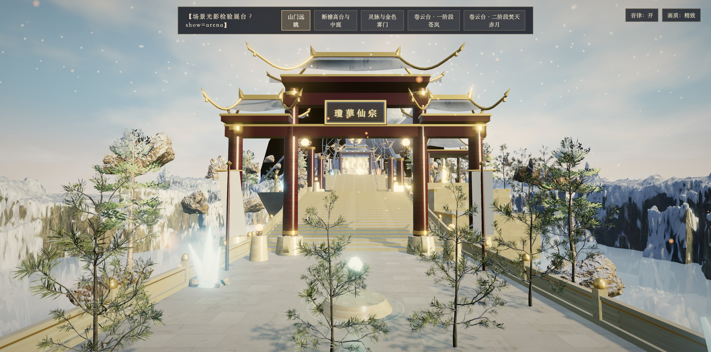

<div align="center">

# 回梦游仙 · 青春版 v2.0 (Dream Wanderer)

**《仙剑奇侠传四》「冰火琼华·登顶卷云台」 × 《艾尔登法环》动漫写实级 3D 魂系动作网页游戏**

[](https://finn-fengming.github.io/Dream-Wanderer/)
[](https://finn-fengming.github.io/Dream-Wanderer/?stage=boss)
[](https://finn-fengming.github.io/Dream-Wanderer/?show=chars&q=ultra)

<br/>

<a href="https://finn-fengming.github.io/Dream-Wanderer/">
  
</a>

*点击上方徽章或封面图即可在浏览器直接开玩（支持键鼠与手机触屏双摇杆，全量 3D 模型与动捕资产流式加载）。*

</div>

---

## ✨ v2.0 动漫写实级美术与引擎全面重构

**《回梦游仙·青春版》v2.0** 基于 **Three.js (WebGL2) + `@pixiv/three-vrm` + TypeScript** 完成了从底层渲染管线、真实 3D 美术资产、中国古典飞檐建筑群到动漫角色骨骼与动作捕捉的全方位重制，以「**动漫般的真实感（Anime-Realistic）**」重现《仙剑奇侠传四》最震撼的宿命终局——**冰火琼华 · 卷云台决战玄霄**。

* **全阵容高精 VRM 动漫角色 + 弹簧骨物理（SpringBone）+ 真实动捕（Mixamo FBX）**：
  * **云天河、玄霄、韩菱纱、柳梦璃、琼华派执剑弟子/御剑修士** 全部升级为真实高面数 `.vrm` 动漫角色，搭载 **MToon 赛璐璐写实明暗着色**、实时发丝/裙摆 **SpringBone 物理飘动**、动态眨眼与战意怒目表情，以及仙侠束腰玉带、开衩战袍/掌门仙袍与披风挂件。
  * 中庭精英 **【镇岳剑傀】** 采用真实高精度重甲武士骨骼模型 + 全套 PBR 金属法线贴图；全角色动作由 **12 套真实光学动捕 `.fbx` 序列** 实时重定向驱动，并与魂系前摇/快劈曲线精准耦合。
* **真实摄影测量昆仑奇峰古松 + 纯正中国古典重檐歇山飞檐建筑群**：
  * 采集并整合 **85 MB 高品质 3D 模型、HDRI 与 1K PBR 材质库**（含昆仑危崖 `cliff_peak.glb`、悬空奇石 `boulder_01/02.glb`、千年迎客古松 `chinese_pine.glb`、太一仙像 `immortal_statue.glb`、鎏金宫灯 `palace_lantern.glb`、真实月球法线贴图与天光环境探针 `sky_probe.hdr`）。
  * 构建纯正 **三间五楼「瓊華仙宗」山门牌坊**、**汉白玉云头望柱雕花栏杆**、**断檐观云仙亭** 以及远方层峦托举的三重飞檐 **「太一仙宫」**；所有山石、松枝与琉璃青瓦均挂载 **世界法线昆仑积雪着色器（World-Space Snow Accumulation Shader）**。
* **电影级动漫写实渲染管线**：
  * HDRI `PMREM` 环境高光反射 + 跟随角色的 **高分辨率紧致软阴影（PCFSoftShadowMap）** + **2048px 昆仑白玉镶金太极八卦镜面反射（Planar Reflector）** + **UnrealBloom** + **SMAA 抗锯齿** + **动漫鲜活分色调色（ACES Filmic + Split-Toning）**。
* **原谱级《回梦游仙》32 小节动态国风音律**：
  * 内嵌《回梦游仙》双声部原谱（262 主旋律音符 + 232 古筝伴奏音符），WebAudio 实时合成竹笛、古筝、琵琶轮指与中国战鼓，随探索、一阶段苍岚、二阶段赤月蚀日无缝变奏。

---

## 🖼️ v2.0 实机画面一览

<div align="center">
  
  <p><em>琼华外山门远眺：三间五楼飞檐翘角牌坊、汉白玉望柱栏杆、千年古松与昆仑积雪云海</em></p>
</div>

| 中庭太极广场 · 越肩迎战重甲【镇岳剑傀】 | 卷云台二阶段 · 菱纱梦璃同框共战【焚天成魔·玄霄】 |
| :---: | :---: |
|  |  |
| **云天河挥动寒晶望舒剑，协同对决 3.2m 重甲镇岳剑傀与琼华弟子** | **赤月蚀日天象下，召唤韩菱纱 & 柳梦璃迎战九柄焚天剑翼玄霄** |

<div align="center">
  
  <p><em>斩落二阶段玄霄结算演出：「宿 孽 获 诛」书法金字与百年青鸾峰回梦尾声</em></p>
</div>

---

## ⚔️ 《艾尔登法环》×《仙剑四》1:1 核心机制映射

| 《艾尔登法环》原版机制 | 《回梦游仙·青春版》仙剑映射 | 玩法细节说明 |
| :--- | :--- | :--- |
| **红 / 蓝 / 绿三色状态条** | **精（气血）/ 神（仙术）/ 气（精力）** | 绿条「气」严谨约束出剑、冲刺、翻滚与格挡；附带法环同款 **延迟扣血黄条**。 |
| **轻重连斩 & 腾空跳劈** | **望舒剑法（三连轻斩 / 蓄力重劈 / 坠星跳劈）** | 含攻击滑步吸附、按角色独立命中顿帧（Hit-stop）与噪声侵蚀弧形丝带刀光；**跳跃腾空可无伤躲过地面扩散震波**。 |
| **翻滚无敌帧（Dodge Roll）** | **踏步掠影（0.35s 核心无敌帧）** | 最高响应优先级，可随时打断出招后摇、蓄力与饮药动作。 |
| **防御反击 & 战技弹反** | **横剑格挡防反 & 剑气弹反（Parry）** | 挡住攻击瞬间按左键触发清脆金石防反音与高削韧重斩；`Q` 键精准弹反直接打崩敌方架势。 |
| **架势破韧与致命处决** | **护体剑罡崩解 &【御剑贯心】** | 蓄力劈、跳劈、防反打空敌方护体剑罡后，触发重低音钟鸣与单膝跪地，近身左键施展无敌处决！ |
| **双战灰切换（Ash of War）** | **【狂龙迅影斩】&【恸天贯日式·射日弓】** | 按 `Tab` 随时切换：居合寒芒突刺留延迟冰爆，或摘下背后【后羿射日弓】射出贯空赤金日轮箭。 |
| **赐福点 & 圣杯瓶 & 跑尸** | **【天地灵脉】、【鼠儿果露】、【残剑剑魄】** | 坐灵脉回满灵露、消耗「灵蕴」淬炼体魄/剑意、聆听菱纱与梦璃残影寄语；战败「梦碎」后可跑尸拾回遗落灵蕴。 |
| **骨灰召唤（Spirit Ashes）** | **【回梦灵契 · 故人幻影】** | 进入卷云台金色剑幕后左侧灵契亮起，按 `V` 吹笛召唤 **韩菱纱（双剑游走牵制）** 与 **柳梦璃（箜篌音律追击+回血阵）** 并肩作战！ |

---

## 🎮 操作指南

| 动作 | 键盘 + 鼠标 | 备选纯键盘 / 触屏 |
| :--- | :--- | :--- |
| **移动 / 冲刺** | `W A S D` / 按住 `Shift` | 移动端左下虚拟摇杆 |
| **踏步翻滚（无敌帧）** | 点按 `Shift` | `L` 键 / 触屏「翻滚」 |
| **轻斩三连 / 处决** | 点按 `鼠标左键` | `J` 键 / 触屏「出剑」 |
| **蓄力重劈 / 卸力防反** | 长按 `鼠标左键` | `H` 键 |
| **跳跃 / 腾空跳劈** | `Space` / 空中 `鼠标左键` | 触屏「跳跃」 |
| **横剑格挡 / 剑气弹反** | 按住 `鼠标右键` / `Q` | `K` 键 / `Q` 键 |
| **施展剑诀战技 / 切换战技** | `F` / `Tab`（或 `1` `2`） | 触屏「剑诀」 |
| **饮用灵药 / 切换红蓝瓶** | `R` / `C` | 触屏「饮药」 |
| **锁定目标 / 切换锁定** | `鼠标中键` 或 `Z` / `滚轮` | 触屏「锁定」 |
| **灵脉、拾取、穿雾门互动** | `E`（或直接点击提示条） | 点击屏幕互动提示 |
| **吹笛召唤菱纱 & 梦璃助战** | `V`（进入 Boss 金色雾门后可用） | — |
| **工程实时帧率与状态诊断** | `F3` | URL 加 `?debug=1` |

---

## 🔬 研发检验展台（URL 参数直达）

* 🏔️ **琼华仙境光影与一/二阶段天象检验台**：[`?show=arena&q=ultra`](https://finn-fengming.github.io/Dream-Wanderer/?show=arena&q=ultra)
* 🗡️ **仙剑四 VRM 全角色、重甲剑傀与神兵拆解台**：[`?show=chars&q=ultra`](https://finn-fengming.github.io/Dream-Wanderer/?show=chars&q=ultra)
* 🔥 **跳过山道直达卷云台金色雾门前**：[`?stage=boss`](https://finn-fengming.github.io/Dream-Wanderer/?stage=boss)
* 🛡️ **无敌测招 + F3 实时碰撞/状态面板**：[`?stage=boss&god=1&debug=1`](https://finn-fengming.github.io/Dream-Wanderer/?stage=boss&god=1&debug=1)

---

## 🛠️ 本地运行与构建

环境要求：**Node.js 18+**。

```bash
# 1. 安装依赖
npm install

# 2. 启动本地开发热更新服务器
npm run dev

# 3. 生产构建（输出至 dist/，含全套 3D 资产供 GitHub Pages 部署）
npm run build
```

### 目录结构

```text
Dream-Wanderer/
├── index.html                    # 游戏首屏入口与实时资产流式加载进度条
├── public/assets/                # 85MB 真实 3D 美术资产库 (.vrm 角色 / .glb 山石松柏宫灯 / .fbx 动捕 / .hdr / PBR 贴图)
├── docs/media/                   # v2.0 实机高清截图
└── src/
    ├── main.ts                   # 主循环、异步资产预热调度与 window.G 自检接口
    ├── assets/assetLoader.ts     # 统一 HDRI/PBR/GLB(Meshopt)/FBX/VRM 异步加载与实例池管理
    ├── core/                     # WebGL2 渲染管线 (HDRI + HalfFloat MSAA + UnrealBloom + SMAA + 动漫鲜活调色)
    ├── camera/                   # 法环式越肩弹簧臂相机、目标软硬锁定与建筑半透明遮挡避让
    ├── world/                    # 中国古典飞檐歇山建筑生成器、世界法线积雪着色器、2K 白玉镶金太极镜面关卡
    ├── entities/                 # VRM MToon 动漫角色 + Mixamo 动捕重定向、重甲剑傀、望舒/羲和/射日弓与双阶段玄霄
    ├── combat/                   # 云天河全状态机（轻重斩/跳劈/翻滚/防反/弹反/双战技/御剑贯心处决）
    ├── vfx/                      # 动态弧形丝带刀光着色器、方向火花、跳跃冲击环与三层掉落光柱
    ├── audio/                    # 《回梦游仙》32 小节原谱序列与 WebAudio 竹笛/古筝/琵琶/战鼓合成器
    ├── ui/                       # 国风魂系 HUD（延迟黄条）、灵脉修行面板、书法横幅与触屏摇杆
    └── showcase/                 # ?show=chars 角色与神兵近景检验展台
```

---

## 📜 致敬与声明

* 世界观角色与《回梦游仙》旋律致敬上海软星经典单机作品 **《仙剑奇侠传四》**；核心战斗交互致敬 FromSoftware **《艾尔登法环》**。
* 3D 环境材质与自然资产源自 CC0 / MIT 开源社区（PolyHaven、VRoid CC0 Samples 等），仅用于实时渲染技术学习与非商业同人致敬展示。
