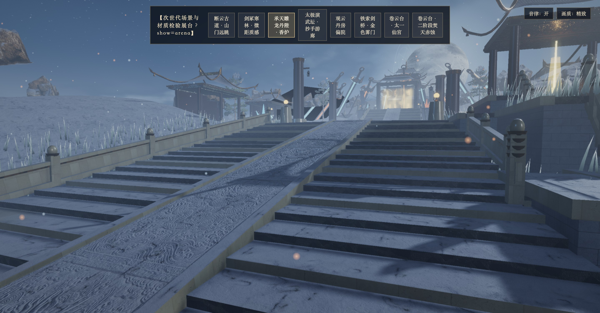
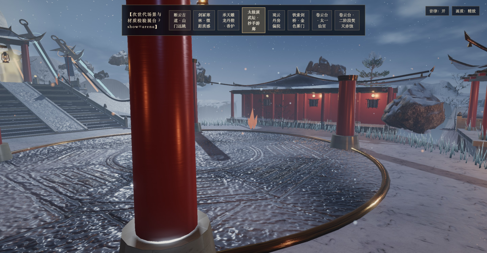
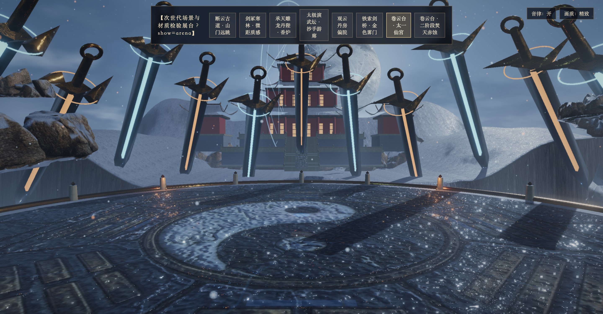
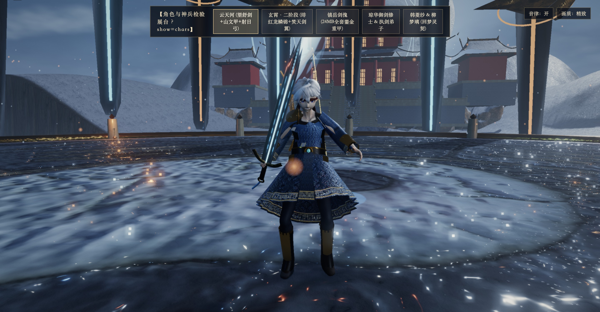
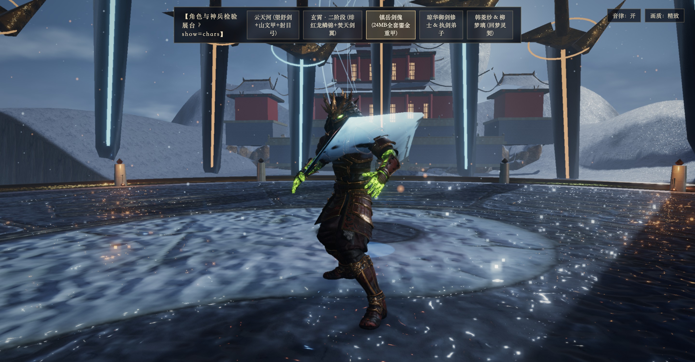
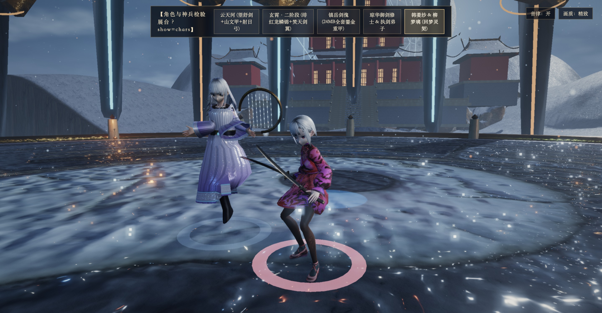
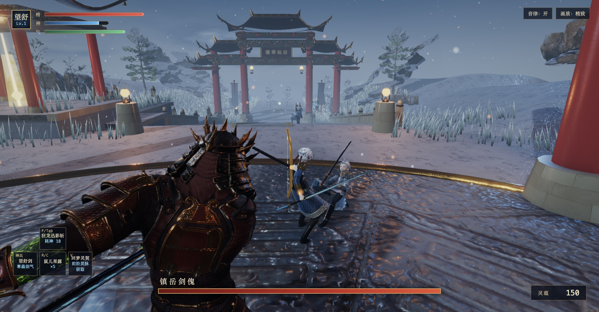
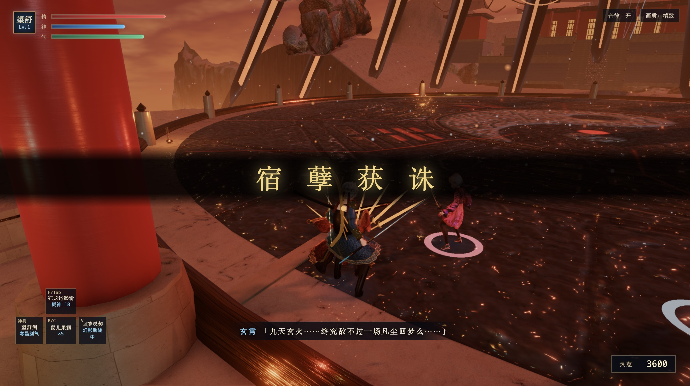

<div align="center">

# 回梦游仙 · 青春版 v4.0 (Dream Wanderer)

**《仙剑奇侠传四》「冰火琼华·登顶卷云台」 × 《艾尔登法环》次世代 PBR 体积光影 · 连续昆仑仙山 · 双骨骼足部 IK · 2K 云锦山文甲 3D 动作网页游戏**

[](https://finn-fengming.github.io/Dream-Wanderer/)
[](https://finn-fengming.github.io/Dream-Wanderer/?stage=boss)
[](https://finn-fengming.github.io/Dream-Wanderer/?show=chars&q=ultra)
[](https://finn-fengming.github.io/Dream-Wanderer/?show=arena&q=ultra)

<br/>

<a href="https://finn-fengming.github.io/Dream-Wanderer/">
  
</a>

*点击上方徽章或封面图即可在浏览器直接开玩（支持键鼠与手机触屏双摇杆，`Ultra` 极高画质实测 **70–86 FPS** 丝滑运行）。*

</div>

---

## 🌟 v4.0 次世代全面重构亮点（光影 / 地图 / 防穿模 IK / 角色 / 动捕）

针对 WebGL 3D 动作游戏常见的「塑料着色感、积木式悬空地形、台阶脚踝穿模、角色素色贴图与生硬动作切帧」五大痛点，**v4.0** 彻底放开资产规格上限（75+ 高清 2K 四通道 PBR 贴图、2K 寒夜苍月 HDRI、24MB 全套金属重甲材质库、46 套 RPG 动捕动作库与真实挥剑破空音效），完成了从渲染管线到骨骼动力学底层的全方位重铸：

1. **电影级非塑料 PBR 体积光影管线（`src/core/postfx/` + `src/world/surfaceMaterials.ts`）**：
   * **双尺度屏幕空间接触环境光遮蔽（`ContactAOPass`）**：基于半分辨率深度重建与保边双边滤波，精准压实每一级石阶阴角、廊柱础石、斗拱飞檐与角色战靴底部的接触阴影，零额外几何 Pass。
   * **阴影采样丁达尔体积雾（`VolumetricAtmospherePass`）**：步进采样主光源 `2048/3072` 阴影贴图与昆仑峡谷层积寒雾，呈现冷冽苍月丁达尔光束与二阶段「赤月蚀日」焚天血雾过渡。
   * **冷暖高反差光源调度（`KunlunLightingRig`）**：苍青寒月主光 + 边缘补光 + 最近 **10 盏暖金宫灯/青铜香炉/火盆动态点光源池**，配合 AgX/ACES 混合色调映射、冷青/暖金分离调色与 CAS 自适应微锐化（`FinalCompositePass`）。
   * **米制物理 UV 与多层风化微表面（`applyKunlunSurfaceShader`）**：全场景建筑按真实世界米制（`uvPerMeter`）展平 `uv` 与 `uv1`；融合 2K 四通道 PBR（`Color` / `Normal` / `Roughness` / `AO`）、微法线细节、法线方差粗糙度抗高光闪烁、冰釉反射与 **实时踩雪凹陷脚印追踪（`SnowFootprintTracker`）**。
2. **连续雕塑级昆仑仙山与四大古建景观区（`src/world/qionghuaWorld.ts` + `chineseArchitecture.ts`）**：
   * **告别悬空长方体盒子**：构建 264 米连续起伏的昆仑雪山脊线与冰渊绝壁，融合摄影测量断崖、古松盘根与寒山蕨草。
   * **四大高密度仙侠景观**：① **断云剑冢寒林**（`14,000+` 株 GPU 实例化风动霜草并支持角色踏草分开、剑冢残碑与古剑林、木制山道石灯）$\rightarrow$ ② **三间五楼旋子彩画山门牌坊、青铜瑞烟香炉、承天云龙浮雕丹陛御路与观云丹房偏院** $\rightarrow$ ③ **朱红雕花抄手游廊（悬垂宫廷华灯）、蟠龙金柱与太极阴阳白玉演武坛** $\rightarrow$ ④ **锁妖玄铁悬索剑桥、十一柄铭文镇山巨剑、实时冰面镜面反射卷云台与三层重檐须弥座【太一仙宫】**。
3. **真实三角面射线碰撞器 + 双骨骼解析足部 IK = 全程零穿模（`collisionWorld.ts` + `ikSolver.ts`）**：
   * 废除分段硬编码高度公式，构建双层空间哈希三角面网格（`walkGrid` 无阻滞斜面胶囊包络 + `footGrid` 逐级真实石阶踏面），经 `window.G.scanMap()` 全山脊 **329 点连续性扫描 0 断点**。
   * 动作重定向自动校准绑定态脚底归零（`y = 0.000m`），配合逐帧双足射线测高、骨盆自适应下沉与 **双骨骼解析腿部 IK（`CharacterFootIK`）**，在雕龙石阶与斜坡上实现前脚踏高阶屈膝、后脚踩低阶伸展的真实贴地表现。
4. **2K 织金云锦 × 立体雕塑山文甲角色 & 46 式惯性混合动捕（`xianxiaGarments.ts` + `xianxiaRig.ts`）**：
   * **高精材质与立体甲胄**：实时合成 2K 国风织金云锦（冰蓝/绯红/烟紫暗花绫罗 + Sobel 丝绸织纹法线与真丝光泽 `MeshPhysicalMaterial` sheen），加装 3D 雕塑 **吞肩兽云头护肩、山文甲护臂与佩楯、蟠龙白玉带扣、浮雕革制护胫战靴**；中庭精英【镇岳剑傀】搭载完整 **24MB 多部位鎏金玄铁重甲四通道 PBR**。
   * **46 式全动作库与五段刀速曲线**：整合 **Quaternius 46 式 RPG 动作库（`ual_46_anims.glb`）** 与 Mixamo 剑术套组，支持指数惯性权重平滑过渡、探索态自动收剑入背鞘、五段非线性力量挥砍曲线（蓄势 $\rightarrow$ 破空加速 $\rightarrow$ 命中顿帧 $\rightarrow$ 剑势延展 $\rightarrow$ 收剑归位）以及 9 组真实破空剑鸣采样。

---

## 🏔️ v4.0 昆仑琼华四大景观与建筑细节实拍

<div align="center">
  
  <p><em>断云古道·剑冢寒林远眺（Ultra 72–86 FPS）：1.4 万株风动霜草、剑冢残碑、三间五楼旋子彩画牌坊与远方层叠仙宫</em></p>
</div>

| 承天雕龙丹陛御路 · 瑞烟青铜鼎炉 | 太极阴阳白玉演武坛 · 朱红雕花抄手游廊 |
| :---: | :---: |
|  |  |
| **2K 蟠龙祥云石雕浮雕法线、逐级倒角汉白玉踏步与接触 AO** | **阴阳双鱼白玉浮雕、朱红游廊宫灯暖光池与锁妖玄铁悬索** |

<div align="center">
  
  <p><em>卷云台巅仰望：巨型 3D 法线苍月、十一柄悬空镇山巨剑、实时冰面反射与三层汉白玉须弥座【太一仙宫】</em></p>
</div>

---

## 🗡️ v4.0 全角色 2K 织金云锦 · 立体山文甲与神兵近景

| 云天河（2K 冰蓝织金云锦 · 吞肩兽山文甲 · 望舒剑 & 射日弓） | 玄霄·二阶段（绯红龙鳞织金锦 · 紫金莲冠 · 羲和剑 & 焚天九剑翼） |
| :---: | :---: |
|  |  |
| **镇岳剑傀（3.15m 全套鎏金玄铁板甲/锁子甲四通道 PBR + 镇岳巨剑）** | **琼华御剑修士 & 执剑弟子（苍岚云锦道袍 · 山文护腕 · 护体飞剑）** |
|  |  |

<div align="center">
  
  <p><em>回梦灵契双女主助战幻影：韩菱纱（绯红暗纹劲装 · 双短剑）& 柳梦璃（2K 烟紫云锦齐胸襦裙 · 幻瞑箜篌）</em></p>
</div>

---

## ⚔️ v4.0 实机战斗画面一览（双骨骼足部 IK · 零穿模验证）

| 雕龙丹陛石阶迎敌（双骨骼腿部 IK 逐级贴合石阶 0 穿模） | 太极演武坛中庭激战 3.15m 重甲【镇岳剑傀】 |
| :---: | :---: |
|  |  |
| **卷云台二阶段 · 召唤菱纱梦璃共战【焚天成魔·玄霄】** | **斩落玄霄结算演出 ·「宿 孽 获 诛」** |
|  |  |

---

## ⚔️ 《艾尔登法环》×《仙剑四》1:1 核心机制映射

| 《艾尔登法环》原版机制 | 《回梦游仙·青春版》仙剑映射 | 玩法细节说明 |
| :--- | :--- | :--- |
| **红 / 蓝 / 绿三色状态条** | **精（气血）/ 神（仙术）/ 气（精力）** | 绿条「气」严谨约束出剑、冲刺、翻滚与格挡；附带法环同款 **延迟扣血黄条**。 |
| **轻重连斩 & 腾空跳劈** | **望舒剑法（三连轻斩 / 蓄力重劈 / 坠星跳劈）** | 含五段非线性力量曲线、滑步吸附、独立命中顿帧（Hit-stop）与水墨寒霜双层刀光；**跳跃腾空可无伤躲过地面扩散震波**。 |
| **翻滚无敌帧（Dodge Roll）** | **踏步掠影（真实前空翻滚 0.35s 核心无敌帧）** | 最高响应优先级，采用 46 式动捕真实战术翻滚，可随时打断出招后摇、蓄力与饮药动作。 |
| **防御反击 & 战技弹反** | **横剑格挡防反 & 剑气弹反（Parry）** | 挡住攻击瞬间按左键触发清脆金石防反音与高削韧重斩；`Q` 键精准弹反直接打崩敌方架势。 |
| **架势破韧与致命处决** | **护体剑罡崩解 &【御剑贯心】** | 蓄力劈、跳劈、防反打空敌方护体剑罡后，触发重低音钟鸣与单膝跪地，近身左键施展无敌处决！ |
| **双战灰切换（Ash of War）** | **【狂龙迅影斩】&【恸天贯日式·射日弓】** | 按 `Tab` 随时切换：居合寒芒突刺留延迟冰爆，或摘下背后【后羿射日弓】射出贯空赤金日轮箭。 |
| **赐福点 & 圣杯瓶 & 跑尸** | **【天地灵脉】、【鼠儿果露】、【残剑剑魄】** | 坐灵脉膝坐调息回满灵露、消耗「灵蕴」淬炼体魄/剑意、聆听菱纱与梦璃残影寄语；战败「梦碎」后可跑尸拾回遗落灵蕴。 |
| **骨灰召唤（Spirit Ashes）** | **【回梦灵契 · 故人幻影】** | 进入卷云台金色剑幕后左侧灵契亮起，按 `V` 吹笛召唤 **韩菱纱（双剑游走牵制）** 与 **柳梦璃（箜篌音律追击+回血阵）** 并肩作战！ |

---

## 🎮 操作指南

| 动作 | 键盘 + 鼠标 | 备选纯键盘 / 触屏 |
| :--- | :--- | :--- |
| **移动 / 冲刺** | `W A S D` / 按住 `Shift` | 移动端左下虚拟摇杆 |
| **踏步翻滚（无敌帧）** | 点按 `Shift` | `L` 键 / 触屏「翻滚」 |
| **轻斩三连 / 处决** | 点按 `鼠标左键` | `J` 键 / 触屏「出剑」 |
| **蓄力重劈 / 卸力防反** | 长按 `鼠标左键` | `H` 键 |
| **跳跃 / 腾空跳劈** | `Space` / 空中 `鼠标左键` | 触屏「跳跃」 |
| **横剑格挡 / 剑气弹反** | 按住 `鼠标右键` / `Q` | `K` 键 / `Q` 键 |
| **施展剑诀战技 / 切换战技** | `F` / `Tab`（或 `1` `2`） | 触屏「剑诀」 |
| **饮用灵药 / 切换红蓝瓶** | `R` / `C` | 触屏「饮药」 |
| **锁定目标 / 切换锁定** | `鼠标中键` 或 `Z` / `滚轮` | 触屏「锁定」 |
| **灵脉、拾取、穿雾门互动** | `E`（或直接点击提示条） | 点击屏幕互动提示 |
| **吹笛召唤菱纱 & 梦璃助战** | `V`（进入 Boss 金色雾门后可用） | — |
| **工程实时帧率/DrawCall诊断** | `F3` | URL 加 `?debug=1` |

---

## 🔬 研发检验展台（URL 参数直达）

* 🗡️ **仙剑四全角色 2K 云锦山文甲与神兵拆解台**：[`?show=chars&q=ultra`](https://finn-fengming.github.io/Dream-Wanderer/?show=chars&q=ultra)
* 🏔️ **琼华仙境八机位景观与二阶段天象检验台**：[`?show=arena&q=ultra`](https://finn-fengming.github.io/Dream-Wanderer/?show=arena&q=ultra)
* 🪨 **微距石雕丹陛、积雪法线与接触 AO 材质检验台**：[`?show=mats&q=ultra`](https://finn-fengming.github.io/Dream-Wanderer/?show=mats&q=ultra)
* 🔥 **跳过山道直达卷云台金色雾门前**：[`?stage=boss`](https://finn-fengming.github.io/Dream-Wanderer/?stage=boss)
* 🛡️ **无敌测招 + F3 实时帧率/DrawCall/三角面面板**：[`?stage=boss&god=1&debug=1`](https://finn-fengming.github.io/Dream-Wanderer/?stage=boss&god=1&debug=1)

---

## 🛠️ 本地运行与构建

环境要求：**Node.js 18+**。

```bash
# 1. 安装依赖
npm install

# 2. 启动本地开发热更新服务器
npm run dev

# 3. 生产构建（TypeScript 严格零报错校验 + 输出全套 2K PBR 与 3D 资产至 dist/）
npm run build
```

---

## 📜 致敬与声明

* 世界观角色与《回梦游仙》旋律致敬上海软星经典单机作品 **《仙剑奇侠传四》**；核心战斗交互致敬 FromSoftware **《艾尔登法环》**。
* 3D 环境材质、动作与音效资产源自 CC0 / MIT 开源社区（PolyHaven、Quaternius Universal Animation Library、VRoid CC0 Samples 等），仅用于实时渲染技术学习与非商业同人致敬展示。
