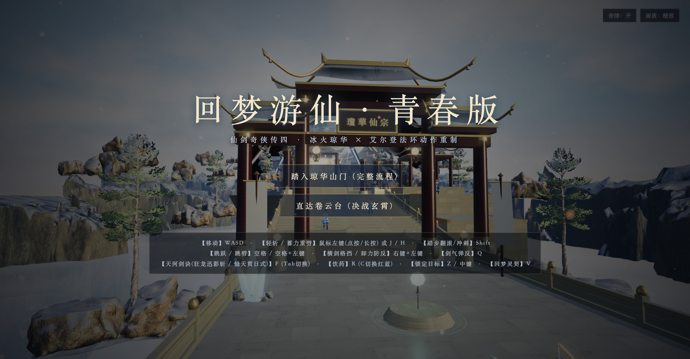
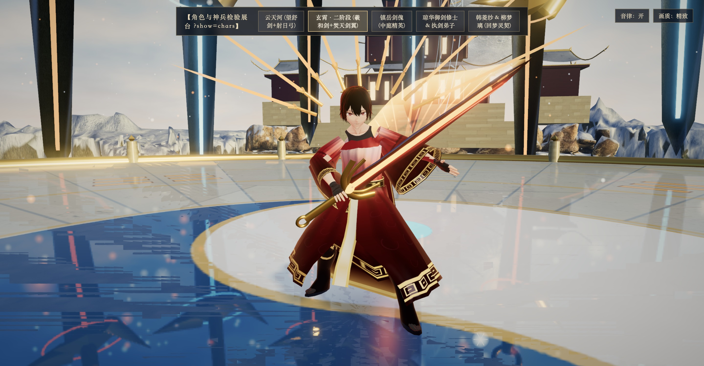
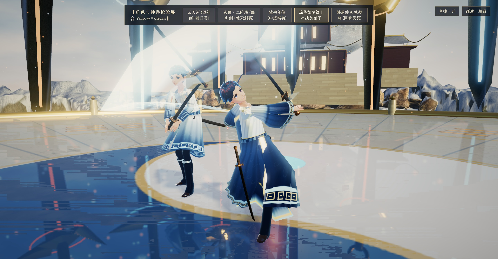
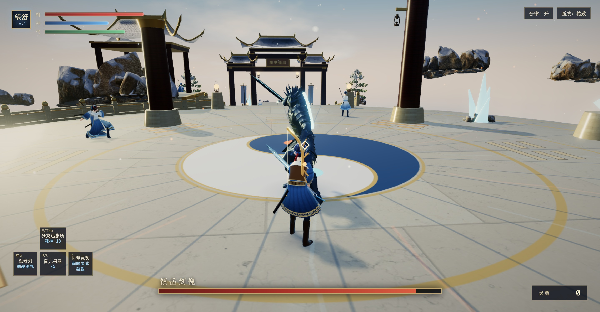

<div align="center">

# 回梦游仙 · 青春版 v3.0 (Dream Wanderer)

**《仙剑奇侠传四》「冰火琼华·登顶卷云台」 × 《艾尔登法环》丝滑高帧率 · 纯正古风仙侠 3D 动作网页游戏**

[](https://finn-fengming.github.io/Dream-Wanderer/)
[](https://finn-fengming.github.io/Dream-Wanderer/?stage=boss)
[](https://finn-fengming.github.io/Dream-Wanderer/?show=chars&q=ultra)

<br/>

<a href="https://finn-fengming.github.io/Dream-Wanderer/">
  
</a>

*点击上方徽章或封面图即可在浏览器直接开玩（支持键鼠与手机触屏双摇杆，实测 **75–107 FPS** 丝滑运行）。*

</div>

---

## 🚀 v3.0 核心升级：丝滑百帧性能优化 & 全角色真多骨骼古风仙袍重塑

针对大型 WebGL 场景帧率瓶颈与角色古风质感问题，**v3.0** 从离线资产拓扑减面、GPU 批次合并、蒙皮制衣算法与角色动漫光影四个维度完成了彻底重构：

1. **全流程 75–107 FPS 丝滑高帧率（每帧总三角面降低 ~95%，Draw Calls 降低 ~85%）**：
   * **离线高精度法线保留减面**：环境摄影测量山石、古松、宫灯与仙像模型总包体由 `24 MB` 精简至 `4.5 MB`（保留全部 1K 法线/粗糙度细节，悬空奇石由 `9.8万面/块` 降至 `2,155面/块`）。
   * **VRM 发丝单批次合并 + 静态建筑空间合批 + GPU 实例化**：自动剥离冗余双通道描边并将单角色 `80–118` 个独立发丝 `SkinnedMesh` 合并为 **1 次 Draw Call**（100% 保留 `SpringBone` 物理飘动）；24 座昆仑浮石转为单次 `THREE.InstancedMesh`；山门、回廊、望柱与太一仙宫按材质与空间扇区静态合批；卷云台冰面 `Reflector` 实施距离门控（山门/中庭 0 反射开销）。
2. **彻底剥离现代常服，量体剪裁多骨骼 GPU 蒙皮古风仙侠华服（`src/entities/xianxiaGarments.ts`）**：
   * 离线剥离原始 VRM 的现代毛衣/水手服/运动裤图元，实时测量每具角色 3D 躯干轮廓，构建 **1 Draw Call 无缝贴身中衣/绑腿内衬 + 外层立体交领右衽仙襦 + 骨骼切向对齐流云广袖/鎏金护腕 + 蟠龙白玉腰扣蔽膝 + 随双腿骨骼自然分合的百褶织金回纹下摆 + 云头护胫战靴**，蹲斩、拉弓、翻滚全程 **0 穿模、0 僵硬几何圆筒**。
3. **原神级赛璐璐半兰伯特（Half-Lambert Cel-PBR）+ 精雕篆纹神兵**：
   * 平衡全局曝光（`1.02`）与 MToon 面部暖色阴影阶梯，彻底消除强光下「惨白死白脸」；重铸六棱开刃发光篆铭 **【望舒寒晶剑】**、太阳神鸟曲翼 **【羲和阳炎剑】**、**【焚天九剑翼】**、**【后羿射日弓】** 与 **【镇岳玄铁巨剑】**。

---

## 🗡️ v3.0 全角色多骨骼古风仙袍与神兵近景一览

| 云天河（翻毛兽皮坎肩 · 织金回纹劲装 · 望舒剑 & 射日弓） | 玄霄·二阶段（紫金莲冠 · 流云织金广袖仙袍 · 羲和剑 & 九剑翼） |
| :---: | :---: |
|  |  |
| **琼华御剑修士 & 执剑弟子（苍岚渐变道袍 · 白玉莲冠 · 护体飞剑）** | **韩菱纱 & 柳梦璃（织锦红绫旗袍双剑 · 烟紫齐胸广袖襦裙箜篌）** |
|  |  |

---

## 🖼️ v3.0 实机战斗画面一览

<div align="center">
  
  <p><em>琼华外山门远眺（106 FPS）：三间五楼飞檐翘角牌坊、汉白玉望柱栏杆、千年古松与昆仑积雪云海</em></p>
</div>

| 中庭太极广场 · 越肩迎战重甲【镇岳剑傀】 | 卷云台二阶段 · 菱纱梦璃同框共战【焚天成魔·玄霄】 |
| :---: | :---: |
|  |  |
| **云天河挥动寒晶望舒剑，协同对决 3.2m 重甲镇岳剑傀与琼华修士** | **赤月蚀日天象下，召唤韩菱纱 & 柳梦璃迎战九柄焚天剑翼玄霄** |

<div align="center">
  
  <p><em>斩落二阶段玄霄结算演出：「宿 孽 获 诛」书法金字与百年青鸾峰回梦尾声</em></p>
</div>

---

## ⚔️ 《艾尔登法环》×《仙剑四》1:1 核心机制映射

| 《艾尔登法环》原版机制 | 《回梦游仙·青春版》仙剑映射 | 玩法细节说明 |
| :--- | :--- | :--- |
| **红 / 蓝 / 绿三色状态条** | **精（气血）/ 神（仙术）/ 气（精力）** | 绿条「气」严谨约束出剑、冲刺、翻滚与格挡；附带法环同款 **延迟扣血黄条**。 |
| **轻重连斩 & 腾空跳劈** | **望舒剑法（三连轻斩 / 蓄力重劈 / 坠星跳劈）** | 含攻击滑步吸附、按角色独立命中顿帧（Hit-stop）与噪声侵蚀弧形丝带刀光；**跳跃腾空可无伤躲过地面扩散震波**。 |
| **翻滚无敌帧（Dodge Roll）** | **踏步掠影（0.35s 核心无敌帧）** | 最高响应优先级，可随时打断出招后摇、蓄力与饮药动作。 |
| **防御反击 & 战技弹反** | **横剑格挡防反 & 剑气弹反（Parry）** | 挡住攻击瞬间按左键触发清脆金石防反音与高削韧重斩；`Q` 键精准弹反直接打崩敌方架势。 |
| **架势破韧与致命处决** | **护体剑罡崩解 &【御剑贯心】** | 蓄力劈、跳劈、防反打空敌方护体剑罡后，触发重低音钟鸣与单膝跪地，近身左键施展无敌处决！ |
| **双战灰切换（Ash of War）** | **【狂龙迅影斩】&【恸天贯日式·射日弓】** | 按 `Tab` 随时切换：居合寒芒突刺留延迟冰爆，或摘下背后【后羿射日弓】射出贯空赤金日轮箭。 |
| **赐福点 & 圣杯瓶 & 跑尸** | **【天地灵脉】、【鼠儿果露】、【残剑剑魄】** | 坐灵脉回满灵露、消耗「灵蕴」淬炼体魄/剑意、聆听菱纱与梦璃残影寄语；战败「梦碎」后可跑尸拾回遗落灵蕴。 |
| **骨灰召唤（Spirit Ashes）** | **【回梦灵契 · 故人幻影】** | 进入卷云台金色剑幕后左侧灵契亮起，按 `V` 吹笛召唤 **韩菱纱（双剑游走牵制）** 与 **柳梦璃（箜篌音律追击+回血阵）** 并肩作战！ |

---

## 🎮 操作指南

| 动作 | 键盘 + 鼠标 | 备选纯键盘 / 触屏 |
| :--- | :--- | :--- |
| **移动 / 冲刺** | `W A S D` / 按住 `Shift` | 移动端左下虚拟摇杆 |
| **踏步翻滚（无敌帧）** | 点按 `Shift` | `L` 键 / 触屏「翻滚」 |
| **轻斩三连 / 处决** | 点按 `鼠标左键` | `J` 键 / 触屏「出剑」 |
| **蓄力重劈 / 卸力防反** | 长按 `鼠标左键` | `H` 键 |
| **跳跃 / 腾空跳劈** | `Space` / 空中 `鼠标左键` | 触屏「跳跃」 |
| **横剑格挡 / 剑气弹反** | 按住 `鼠标右键` / `Q` | `K` 键 / `Q` 键 |
| **施展剑诀战技 / 切换战技** | `F` / `Tab`（或 `1` `2`） | 触屏「剑诀」 |
| **饮用灵药 / 切换红蓝瓶** | `R` / `C` | 触屏「饮药」 |
| **锁定目标 / 切换锁定** | `鼠标中键` 或 `Z` / `滚轮` | 触屏「锁定」 |
| **灵脉、拾取、穿雾门互动** | `E`（或直接点击提示条） | 点击屏幕互动提示 |
| **吹笛召唤菱纱 & 梦璃助战** | `V`（进入 Boss 金色雾门后可用） | — |
| **工程实时帧率/DrawCall诊断** | `F3` | URL 加 `?debug=1` |

---

## 🔬 研发检验展台（URL 参数直达）

* 🗡️ **仙剑四全角色多骨骼古风仙袍与神兵拆解台**：[`?show=chars&q=ultra`](https://finn-fengming.github.io/Dream-Wanderer/?show=chars&q=ultra)
* 🏔️ **琼华仙境光影与一/二阶段天象检验台**：[`?show=arena&q=ultra`](https://finn-fengming.github.io/Dream-Wanderer/?show=arena&q=ultra)
* 🔥 **跳过山道直达卷云台金色雾门前**：[`?stage=boss`](https://finn-fengming.github.io/Dream-Wanderer/?stage=boss)
* 🛡️ **无敌测招 + F3 实时帧率/DrawCall/三角面面板**：[`?stage=boss&god=1&debug=1`](https://finn-fengming.github.io/Dream-Wanderer/?stage=boss&god=1&debug=1)

---

## 🛠️ 本地运行与构建

环境要求：**Node.js 18+**。

```bash
# 1. 安装依赖
npm install

# 2. 启动本地开发热更新服务器
npm run dev

# 3. 生产构建（输出至 dist/，含全套优化后 3D 资产供 GitHub Pages 部署）
npm run build
```

---

## 📜 致敬与声明

* 世界观角色与《回梦游仙》旋律致敬上海软星经典单机作品 **《仙剑奇侠传四》**；核心战斗交互致敬 FromSoftware **《艾尔登法环》**。
* 3D 环境材质与自然资产源自 CC0 / MIT 开源社区（PolyHaven、VRoid CC0 Samples 等），仅用于实时渲染技术学习与非商业同人致敬展示。
